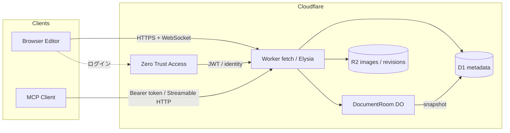
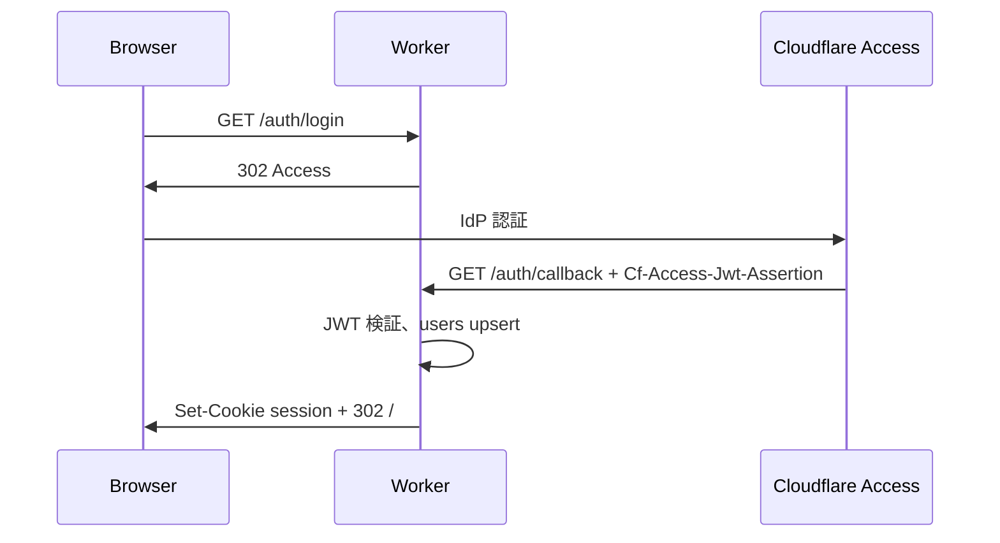
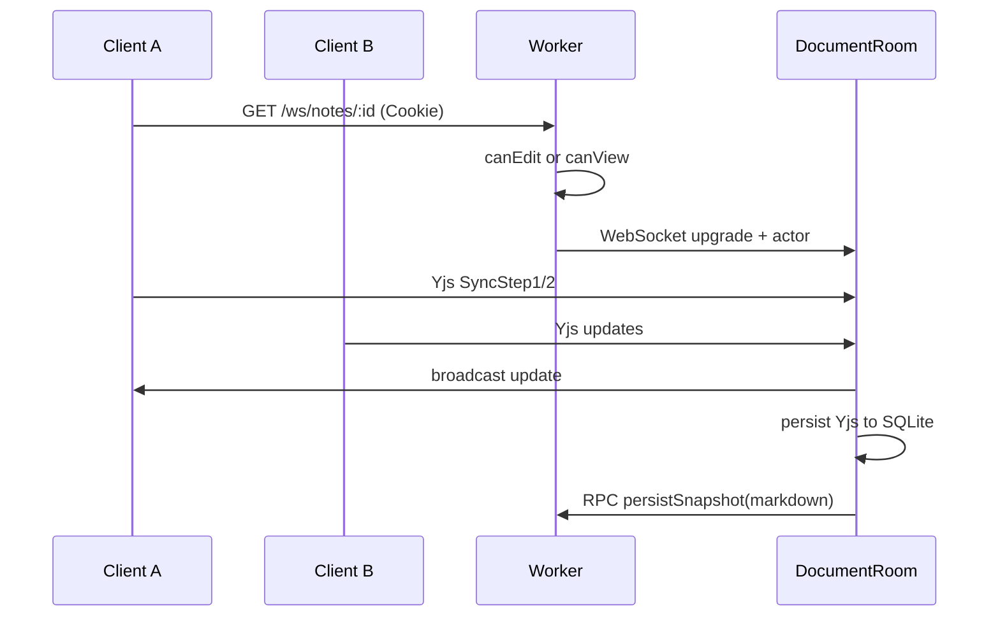

# MiyulabMD 設計書

共同編集できる Markdown エディタ。Cloudflare 上でホストし、CodiMD / HackMD 相当の公開範囲制御と、MCP からのドキュメント編集を提供する。

PWA・ベストエフォートの先読みキャッシュ・オフライン閲覧の仕様は [PWA・オフライン閲覧仕様](offline-pwa.md) を参照。

## 1. 概要

| 項目         | 内容                                                               |
| ------------ | ------------------------------------------------------------------ |
| プロダクト名 | MiyulabMD                                                          |
| 目的         | チーム内外で Markdown を同時編集し、ノート単位で公開範囲を制御する |
| ホスト       | Cloudflare Workers / Durable Objects / D1 / R2 / Access            |
| 編集モデル   | Yjs CRDT（ノートごとに 1 Durable Object）                          |
| 認証         | Cloudflare Zero Trust (Access) によるログイン                      |
| 外部編集     | MCP（Model Context Protocol）                                      |

ブラウザ・MCP クライアントは同じドメインサービスを通す。本文のソース・オブ・トゥルースは Durable Object 上の Yjs ドキュメント、一覧・権限・検索用のメタデータは D1、画像は R2 に置く。

## 2. ゴール / 非ゴール

### ゴール

- 複数人が同じノートを同時編集でき、カーソルと存在（awareness）が見える
- ノートごとに CodiMD 互換の 6 段階公開範囲を設定できる
- Cloudflare Access でログインできる（サイト全体を Access で閉じない）
- 画像のペースト / ドロップを R2 に保存し、ノート権限に従って配信する
- Cursor 等の MCP クライアントからノートの一覧・取得・作成・更新・権限変更ができる
- 単一 Worker で API / WebSocket / 静的配信 / MCP を提供する
- いつ・誰が・どの範囲を・どう編集したかを時系列で見られ、ある時点の本文へ戻せる

### 非ゴール（初期リリース外）

- ブランチ、コメントスレッド、キーストローク再生、ノート横断の履歴検索
- 組織アカウントやチームという利用者（共有ドライブは対象。主体はドライブ自身で、組織ユーザーは作らない）
- WYSIWYG 編集（初期はソース + プレビュー分割）
- 全文検索エンジン（D1 の LIKE / FTS5 で足りる範囲に留める）
- エンドツーエンド暗号

## 3. 全体アーキテクチャ



| コンポーネント            | 役割                                                                          |
| ------------------------- | ----------------------------------------------------------------------------- |
| `apps/web`                | React フロント。CodeMirror 6 + Yjs、プレビュー、権限 UI                       |
| Worker (`fetch` + Elysia) | 入口は `fetch` 分岐。REST / 認証 / MCP は Elysia。WS と Assets は公式ハンドラ |
| `DocumentRoom` DO         | ノート 1 件につき 1 インスタンス。Yjs 同期・awareness・永続化                 |
| D1                        | ユーザー、ノートメタ、権限、招待、API トークン、最新スナップショット、編集イベント、リビジョンメタ |
| R2                        | 貼付画像、リビジョン本文                                                      |
| Access                    | ログイン IdP。公開ノートの閲覧は Worker 側で許可判定する                      |

## 4. 技術選定

| 層         | 選定                                       | 理由                                                                    |
| ---------- | ------------------------------------------ | ----------------------------------------------------------------------- |
| ランタイム | Cloudflare Workers                         | 要件どおり。DO / D1 / R2 / Access と同一基盤                            |
| API        | Elysia (`CloudflareAdapter`)               | 実験用途として採用。スキーマと型推論が強い。Workers 対応は Experimental |
| 共同編集   | Yjs + y-protocols                          | Markdown テキストの CRDT として実績がある                               |
| 同期ハブ   | Durable Objects + WebSocket Hibernation    | ノート単位の一貫性。アイドル時は課金が小さい                            |
| DO 永続化  | DO SQLite                                  | hibernation / 再デプロイ後も Yjs 更新を保持できる                       |
| メタデータ | D1                                         | 権限判定、一覧、MCP の読み取り元                                        |
| 画像       | R2                                         | オブジェクトストレージ。Worker 経由で権限付き配信                       |
| 認証       | Cloudflare Access JWT                      | Zero Trust ログイン。アプリ側セッションに変換する                       |
| フロント   | React + Vite + TypeScript                  | エディタ周辺のエコシステムが広い                                        |
| エディタ   | CodeMirror 6 (`@codemirror/lang-markdown`) | ソース共同編集と Yjs バインディングが明確                               |
| プレビュー | remark / rehype                            | サーバーとクライアントで同じ Markdown パイプラインにできる              |
| MCP        | `agents` の `createMcpHandler`             | MCP 2026-07-28 の stateless Streamable HTTP。DO セッション不要          |
| パッケージ | pnpm workspaces                            | web / worker / shared の型を共有する                                    |

本文の競合解消は CRDT に任せ、OT は採用しない。カーソルは Yjs awareness で同期する。初期は WebRTC は使わない。

Elysia は Bun 向けが本籍で、Workers の `CloudflareAdapter` は公式にも Experimental とある。本リポジトリは実験的プログラムなので、その前提で採用する。既知の制約（Static プラグイン不可、OpenAPI Type Gen 不可、起動前の `Response` 定義不可）は受け入れる。静的配信は Wrangler Assets に任せる。

HTTP の入口はフレームワーク一枚にしない。Worker の `fetch` で経路を分ける。

```ts
export default {
  async fetch(request, env, ctx) {
    const { pathname } = new URL(request.url);
    if (pathname.startsWith("/ws/notes/")) {
      return env.DOCUMENT_ROOM.get(id).fetch(request); // Hibernation は DO
    }
    if (
      pathname.startsWith("/api/") ||
      pathname.startsWith("/auth/") ||
      pathname.startsWith("/mcp")
    ) {
      return api.fetch(request); // Elysia（REST / 認証 / MCP）
    }
    return env.ASSETS.fetch(request);
  },
};
```

Bindings は Elysia ルート内で `import { env } from "cloudflare:workers"` を使う。`waitUntil` が必要な処理は `fetch` 入口の `ctx` から渡す。

MCP は Elysia の `/mcp` に載せ、ルートから `createMcpHandler` に `Request` を渡す。プロトコル処理は Agents SDK のままである。

## 5. 公開範囲（CodiMD 互換）

CodiMD の 6 プリセットをそのまま採用する。変更できるのはノート所有者だけである。

| プリセット  | Owner R/W | ログイン済み Read | ログイン済み Write | Guest Read | Guest Write |
| ----------- | --------- | ----------------- | ------------------ | ---------- | ----------- |
| `freely`    | ✔         | ✔                 | ✔                  | ✔          | ✔           |
| `editable`  | ✔         | ✔                 | ✔                  | ✔          | ✖           |
| `limited`   | ✔         | ✔                 | ✔                  | ✖          | ✖           |
| `locked`    | ✔         | ✔                 | ✖                  | ✔          | ✖           |
| `protected` | ✔         | ✔                 | ✖                  | ✖          | ✖           |
| `private`   | ✔         | ✖                 | ✖                  | ✖          | ✖           |

内部表現はプリセットを分解したポリシーでも保持する。UI はプリセット名を出し、判定は次の関数に集約する。

```ts
type Actor = { kind: "owner" | "signed_in" | "guest"; userId?: string };

function canView(note: Note, actor: Actor): boolean;
function canEdit(note: Note, actor: Actor): boolean;
function canAdmin(note: Note, actor: Actor): boolean; // 権限変更・削除。owner のみ
```

### 5.1 インスタンス設定

CodiMD の匿名設定に相当するフラグを Worker 環境変数で持つ。

| 変数                    | 初期値     | 意味                                         |
| ----------------------- | ---------- | -------------------------------------------- |
| `ALLOW_ANONYMOUS`       | `false`    | ゲストがノートを新規作成できるか             |
| `ALLOW_ANONYMOUS_EDITS` | `true`     | `freely` を選択可能にするか                  |
| `ALLOW_ANONYMOUS_VIEWS` | `true`     | ゲスト閲覧を許すプリセットを有効にするか     |
| `DEFAULT_PERMISSION`    | `editable` | ログインユーザーが作るノートの初期プリセット |

`ALLOW_ANONYMOUS=false` かつ `ALLOW_ANONYMOUS_VIEWS=true` のとき、ゲストは既存ノートの閲覧（と設定次第で `freely` 編集）だけでき、新規作成はログイン必須。CodiMD 2.0 以降と同じ向きにする。

### 5.2 招待（CodiMD からの拡張）

`private` / `protected` でも特定ユーザーを読者または編集者にできる。招待は Access の email と突き合わせる。

| role     | 効果                          |
| -------- | ----------------------------- |
| `viewer` | プリセットが拒否しても閲覧可  |
| `editor` | 閲覧 + 編集可。権限変更は不可 |

招待者はプリセット判定の前に評価する。owner は常に admin。

### 5.3 URL

| 種別             | パス       | 用途                                                            |
| ---------------- | ---------- | --------------------------------------------------------------- |
| 編集             | `/n/:id`   | 編集 UI。権限がなければ 403 / ログイン誘導                      |
| 読み取り専用共有 | `/s/:id`   | プレビューのみ。`canView` を満たせば Access 不要                |
| 公開一覧         | `/explore` | `public` フラグ付き、かつゲストまたはログイン済みが読めるノート |

`id` は ULID。あわせて 8 文字の `short_id` を持ち、どちらでも解決する。任意の `alias`（オーナー配下で一意）も後から足せるようにスキーマを空けておく。

公開「発見可能」と「リンクを知っていれば見られる」は分ける。

- 横断的な一覧・検索（MCP を含む）: `canView` に加えて、所有者・実効閲覧範囲が
  `public`・ログイン済みユーザーに対する `signed_in`・自分への明示共有（ノートまたは祖先フォルダの grant）のいずれかが必要。
- `link` はリンク限定で、ログインだけでは列挙しない。`signed_in`（旧 `limited` / `protected` の閲覧）は
  ログイン済みの共有タブ・検索に出す。ゲストの公開一覧には出さない。
  URLを指定した取得は従来どおり `canView` で判定する。
- ノートの `folderId`、フォルダの `parentId` と祖先のパンくずにも同じ発見可能性を適用する。
  公開された子からリンク限定の親のIDを逆引きできないようにする。
- 既知のフォルダを開いたときは、その設定を継承した子を辿れる。
  子で別途 `link` に上書きされたものは、公開または明示共有がなければ列挙しない。
  `signed_in` に上書きされた子は、ログイン済みユーザーには列挙する。
- 共有先メールを含む `grants` は、非オーナー向けのノート・フォルダ応答には含めない。

`listed` カラムは使わず、実効閲覧範囲で発見可能性を区別する。Explore 専用画面はフェーズ 2。

## 6. 認証（Zero Trust）

「Zero Trust でログインできる」を満たしつつ、ゲスト閲覧を壊さない。Access をサイト全体の壁にはしない。



- Access Application は `/auth/*` にだけ付ける（または Access を OIDC IdP として使う）
- アプリの認可は Worker のセッション Cookie とノート権限で行う
- 公開共有 `/s/:id` は Access を通さない
- セッション Cookie: `HttpOnly`, `Secure`, `SameSite=Lax`。中身は署名付き JWT（ユーザー ID / email / 期限）
- Access JWT の検証は JWKS（チームドメインの certs）で行う。email をユーザーの安定キーにする

MCP と自動化はブラウザの Access を使えない。Cursor などは設定画面の Personal Access Token を使い、SHA-256 ハッシュだけを D1 に保存する。ChatGPT のカスタム MCP は OAuth 2.1（PKCE、S256）で同じユーザーに紐付く。認可サーバーはこの Worker 自身で、ログインは既存の Access セッションを使う。アクセストークンもハッシュだけを保存し、`Authorization: Bearer` で照合する。

管理用のマシンアクセスが必要なら、Access Service Token を追加で受けられるようにする（フェーズ 2）。

## 7. データモデル（D1）

```sql
-- 概念スキーマ。実体は apps/worker/src/db/schema.sql

users (
  id            TEXT PRIMARY KEY,          -- ULID
  email         TEXT NOT NULL UNIQUE,      -- Access identity
  display_name  TEXT,
  created_at    INTEGER NOT NULL,
  last_login_at INTEGER
)

notes (
  id              TEXT PRIMARY KEY,        -- ULID
  short_id        TEXT NOT NULL UNIQUE,
  alias           TEXT UNIQUE,
  owner_id        TEXT NOT NULL,               -- 主体 ID。users への外部キーは外す（§7.2）
  owner_kind      TEXT NOT NULL DEFAULT 'user', -- user | shared_drive
  title           TEXT NOT NULL DEFAULT 'Untitled',
  permission      TEXT NOT NULL,           -- freely|editable|limited|locked|protected|private
  markdown_snapshot TEXT NOT NULL DEFAULT '',
  snapshot_updated_at INTEGER,
  created_at      INTEGER NOT NULL,
  updated_at      INTEGER NOT NULL
)

note_collaborators (
  note_id     TEXT NOT NULL REFERENCES notes(id),
  user_id     TEXT NOT NULL REFERENCES users(id),
  role        TEXT NOT NULL,               -- viewer|editor
  created_at  INTEGER NOT NULL,
  PRIMARY KEY (note_id, user_id)
)

images (
  id          TEXT PRIMARY KEY,
  note_id     TEXT NOT NULL REFERENCES notes(id),
  r2_key      TEXT NOT NULL UNIQUE,
  content_type TEXT NOT NULL,
  byte_size   INTEGER NOT NULL,
  uploader_id TEXT,
  created_at  INTEGER NOT NULL
)

api_tokens (
  id           TEXT PRIMARY KEY,
  user_id      TEXT NOT NULL REFERENCES users(id),
  name         TEXT NOT NULL,
  token_hash   TEXT NOT NULL UNIQUE,       -- SHA-256
  created_at   INTEGER NOT NULL,
  last_used_at INTEGER
)
```

本文の最新状態は DO 内の Yjs。D1 の `markdown_snapshot` は一覧・検索・MCP の読み取り・共有ページの初期表示用。DO がデバウンスして書き戻す（目安: 3 秒）。

ユーザーが未ログインのまま `freely` ノートを編集する場合、`users` 行は作らない。owner がいないノートは初期では作らない（`ALLOW_ANONYMOUS=false`）。将来ゲスト作成を許すなら `owner_id` を NULL 可にする。

### 7.1 編集履歴

「誰がどこをどう変えたか」と「ある時点に戻す」は別物。共同編集では、ある人の差分だけを巻き戻すと他人の同時編集を壊す。

| 層 | 役割 | 保存先 |
| --- | --- | --- |
| 編集イベント | いつ・誰が・どの範囲を・どう変えたか | D1 `note_edit_events` |
| リビジョン | その時点の全文。復元の単位 | D1 `note_revisions`（メタ）+ R2 本文 |

```sql
note_edit_events (
  id            TEXT PRIMARY KEY,
  note_id       TEXT NOT NULL REFERENCES notes(id),
  revision_id   TEXT,                          -- 確定時のリビジョン。後から埋める
  actor_kind    TEXT NOT NULL,                 -- user|agent|guest
  actor_user_id TEXT,
  actor_name    TEXT NOT NULL,                 -- 記録時点の表示名
  started_at    INTEGER NOT NULL,
  ended_at      INTEGER NOT NULL,
  start_offset  INTEGER NOT NULL,
  end_offset    INTEGER NOT NULL,
  op            TEXT NOT NULL,                 -- insert|delete|replace|restore
  excerpt       TEXT NOT NULL,
  created_at    INTEGER NOT NULL
)

note_revisions (
  id            TEXT PRIMARY KEY,
  note_id       TEXT NOT NULL REFERENCES notes(id),
  event_id      TEXT,
  r2_key        TEXT NOT NULL UNIQUE,          -- notes/{noteId}/revisions/{id}.md
  byte_size     INTEGER NOT NULL,
  actor_kind    TEXT NOT NULL,
  actor_user_id TEXT,
  actor_name    TEXT NOT NULL,
  created_at    INTEGER NOT NULL
)
```

方針:

- 記録の入口は DocumentRoom だけ。D1 の `markdown_snapshot` を直接書く経路は履歴を迂回するので使わない
- 粒度はキーストロークではなく、同一アクターの入力セッション（無操作約 3 秒で確定）。MCP の 1 操作は 1 イベント
- 範囲は文字オフセット（開始・終了）と挿入/削除の抜粋
- アクターは `user` / `agent` / `guest`。表示名は記録時点のスナップショット
- 閲覧は `canView`、復元は `canEdit`
- 復元は履歴を消さない。選んだリビジョンの全文を現行 Yjs に載せ、新しい `restore` イベントとリビジョンを足す
- 履歴の書き込み失敗で編集自体は落とさない
- 保持は日数ではなくノートあたりの件数と本文容量。書き込みのたびに間引く（cron は持たない）

初期の非対象: ブランチ、コメント、キーストローク再生、ノート横断検索。

### 保持とコンパクション

よく触るノートだけが膨らむので、期限（日数）は設けない。ノート単位の上限だけを見る。

| 対象 | 上限 | 超過時 |
| --- | --- | --- |
| 編集イベント | 200 件 | 古い行から削除 |
| リビジョン本文 | 80 件、または合計 8MB | 古い R2 本文から削除。イベントの `revision_id` は null |

削除順:

1. リビジョン本文（R2 → `note_revisions` → イベントの `revision_id` を外す）。イベント行は残すので「誰がいつどこを変えたか」は見える
2. それでもイベントが 200 を超えたら、古いイベント行を消す
3. イベントを消したあとに参照の無いリビジョンが残ったら、それも消す

最新 1 件のリビジョンは、本文が 8MB を超えていても残す。復元の起点を無くさないため。`restore` も通常の件数に含める。間引き失敗は次の記録で再試行する。

### 7.2 共有ドライブ

共有ドライブは、ユーザーを所有者にしない根である。中身の主体はドライブ自身で、メンバーが抜けてもノートとフォルダは残る。マイドライブ上の grant（共有フォルダ）とは別物で、画面の「共有」「管理」にも出さない。用語は `CONTEXT.md`、決定の理由は ADR 0006。

`owner_id` は主体 ID として残す。マイドライブではユーザー ID、共有ドライブでは共有ドライブ ID。種別は `owner_kind`。フォルダパスの一意性 `(owner_id, folder)` はそのまま使える。ドライブ ID を入れるための偽ユーザーは作らない。`notes.owner_id` の `users` 外部キーは外す。

```sql
shared_drives (
  id          TEXT PRIMARY KEY,
  name        TEXT NOT NULL,                 -- 全体では一意にしない
  created_by  TEXT NOT NULL,                 -- 作成したユーザー。主体ではない
  created_at  INTEGER NOT NULL
)

shared_drive_members (
  id          TEXT PRIMARY KEY,
  drive_id    TEXT NOT NULL REFERENCES shared_drives(id),
  email       TEXT NOT NULL,
  user_id     TEXT,                          -- 招待中は NULL
  role        TEXT NOT NULL,                 -- manager | editor | viewer
  created_at  INTEGER NOT NULL
)

shared_drive_domains (
  id          TEXT PRIMARY KEY,
  drive_id    TEXT NOT NULL REFERENCES shared_drives(id),
  domain      TEXT NOT NULL,                 -- 小文字。@ は含まない
  role        TEXT NOT NULL,                 -- manager | editor | viewer
  created_at  INTEGER NOT NULL
)

shared_drive_domain_exclusions (
  drive_id    TEXT NOT NULL REFERENCES shared_drives(id),
  email       TEXT NOT NULL,
  PRIMARY KEY (drive_id, email)
)
```

招待中（`user_id` が空）は木の切り替えに出さず、管理者の人数にも数えない。同じドライブの同じメールは一行だけ。ログインしたメールが一致したら、既存の grant と同じく `user_id` を結ぶ。ドライブ作成時に、作成者を `manager` にしたメンバー行と、空パスのルートフォルダを同じ主体で作る。

管理者はドメインと役割を登録できる。メールの `@` より後ろが、登録したドメインと完全一致する人は、ログインするとその役割のメンバーになる。サブドメインは含めない。すでにメンバー行があるメールは、招待した役割のままにする。管理者がその人を外すと、ドメインの規則が残っていても自動では戻らない。戻すには、もう一度招待する。

役割はドライブ全体に一つ。フォルダごとの役割は置かない。ノート共同編集者の `viewer` / `editor` とは別で、こちらは主体への所属である。

| 役割 | コード | できること |
| --- | --- | --- |
| 管理者 | `manager` | 閲覧、中身の編集、編集ロックの施錠と解除、メンバーの招待・役割変更・削除、ドライブの改名と削除。権限フラグは `canView` + `canEdit` + `canAdmin` |
| 編集者 | `editor` | ノートとフォルダの作成・編集・移動・削除・改名。ドライブ内のスペース、メダリオン、命名規則、記事ソースも扱える。メンバー、ドライブ自体、編集ロックは触れない。`canView` + `canEdit` |
| 閲覧者 | `viewer` | 木、本文、メンバー一覧の閲覧だけ。`canView` |

作った人は最初の管理者。最後の管理者は離脱・降格・削除ができない。捨てるには別の管理者を置くか、ドライブごと削除する。削除は管理者だけで、ドライブ名の入力で確認する。配下のノートは通常のノート削除と同じ後処理（DocumentRoom、画像、履歴）に乗せる。

アクセスはメンバーだけ。公開範囲、リンク共有、個別 grant、共有ページ `/s/:id` は使わない。`owner_kind = shared_drive` の判定はメンバー役割だけを見て、`read_scope` / `write_scope` / `access_grants` は無視する。ドライブ内の画面は共有ボタンと公開範囲の編集を出さず、「メンバーのみ」とだけ示す。主体がドライブのノートはオフライン編集資格を持たない（所有者本人かつ実効書き込みスコープが自分のみ、を満たさない）。表示キャッシュでの閲覧は今の規則のまま。

主体をまたぐ移動は、マイドライブと共有ドライブの間、および共有ドライブ同士を許す。ノート ID と Yjs の部屋は変えない。今の移動は同一 `owner_id` だけで、別主体は「別のドライブへは移動できません」と拒否している。この拒否を次の規則に置き換える。

- 移動元で中身を移動できること。マイドライブならそのユーザー。共有ドライブなら編集者か管理者。
- 移動先で中身を作れること。同じ条件。閲覧者のドライブへは入れない。
- 編集ロック中のノートを含む移動は拒否する。
- スペースルート、または命名規則の採番スコープの根は、その割当を解くまで拒否する。
- それ以外の、主体に紐づく属性は外して移す。外すものはメダリオン割当、スペースのバケツ割当、採番 ID、フォルダポリシー、grant。ドライランの計画に、外れる件数を出す。
- 共有ドライブへ入ったノートの公開範囲は参照しない。マイドライブへ出たノートは「自分のみ」になる。
- メダリオンセット、スペース、採番カウンタ自体は相手主体へコピーしない。

ドライブ内の移動は今と同じパス移動で、主体は変えない。編集者以上ができる。

スペース、メダリオンセット、命名規則、記事ソース、採番カウンタは、ドライブの `owner_id` 名前空間に属する。個人のセットやスペースはドライブ内に混ざらない。複合ルール（ADR 0005）は主体の内側で今どおり。スペースルートを共有フォルダに置けない、という既存の禁止はマイドライブ上の共有フォルダの話で、共有ドライブの中にスペースを作ることは許可する。

## 8. 共同編集（Durable Objects）

ノート ID を DO 名にする。同じノートへの接続は必ず同一インスタンスに集約される。



`DocumentRoom` の責務:

- WebSocket Hibernation API で接続を張る
- `y-protocols` の sync / awareness を中継する
- Yjs 更新を DO SQLite に append + 定期コンパクション
- 読み取り専用接続（`locked` のゲストなど）は update を拒否し、awareness は許可してよい
- MCP からの本文変更は `applyEdit` RPC で `Y.Text("markdown")` に差分を載せ、接続中クライアントへ配信する。全文置換は `applyTextDiff` 経由の最終手段
- MCP エージェントは DO 内の合成 awareness（`kind: "agent"`）としてカーソルと presence を出す。ブラウザ側の既存リモートカーソル描画をそのまま使う
- `Y.Text` の observe で delta と origin（WS attachment または MCP agent）を編集イベントに結合し、確定時にリビジョン本文を R2 へ書く

クライアント:

- `y-websocket` 互換、または薄い独自 provider
- `y-codemirror.next` で CodeMirror にバインド
- リッチ（TipTap）も同じ `Y.Text("markdown")` に差分（insert/delete）で載せる。`y-prosemirror` は使わない
- `y-indexeddb` でオフライン下書き（再接続時にマージ）
- awareness に displayName / color / cursor（Y.RelativePosition）を載せる

閲覧のみのユーザーもプレビューをリアルタイム更新するため、view 権限があれば WS 接続を許す。書き込みフレームはサーバーで落とす。

## 9. 画像（R2）

CodiMD はアップロード画像を権限外に公開してしまう。MiyulabMD はノートの `canView` に合わせて配信する。

1. エディタでペースト / ドロップ
2. `POST /api/notes/:id/images`（`canEdit` 必須、最大 10MB、`image/png|jpeg|gif|webp`）
3. R2 キー `notes/{noteId}/{imageId}.{ext}`
4. 挿入文字列 ``
5. `GET` は `canView` を満たすときだけ R2 から返す

削除はノート削除時に一括、または画像 ID 単位（`canEdit`）。公開ノートの画像も直リンクは Worker を通るため、ノートを `private` に戻した時点で外部からの取得を止められる。

## 10. MCP

同一 Worker の `/mcp` を Elysia ルートとして持ち、中で Cloudflare Agents SDK の `createMcpHandler` に `Request` を渡す。MCP 2026-07-28 の stateless Streamable HTTP を正面に据える。セッション用 Durable Object は持たない。

認証: `Authorization: Bearer` の Personal Access Token、または OAuth アクセストークン。トークンのユーザーで `canView` / `canEdit` / `canAdmin` を評価する。トークン無し・無効は 401 と `WWW-Authenticate`（protected resource metadata）を返す。ゲスト権限での MCP は提供しない。

OAuth は認可コード + PKCE（S256）のみ。公開クライアント（`token_endpoint_auth_method=none`）に限り、Client ID Metadata Documents と Dynamic Client Registration を受け付ける。`resource` は `{origin}/mcp` に固定する。同意画面はブラウザセッションが無いとき `/auth/login` に戻り、許可後だけ認可コードを返す。発行したアクセストークンは `/mcp` 以外では受け付けない。

CPU 使用量とツールごとの所要時間の調べ方は [MCP の処理時間と CPU 使用量](mcp-performance.md) を参照。

### ツール

| ツール                | 権限             | 内容                                                                         |
| --------------------- | ---------------- | ---------------------------------------------------------------------------- |
| `list_notes`          | ログインユーザー | 自分が owner / collaborator のノート。任意で query                           |
| `get_note`            | `canView`        | メタ + DO の最新 Markdown + heading outline。`AI(ユーザー名)` カーソルを出す |
| `create_note`         | ログインユーザー | title / content / permission                                                 |
| `replace_in_note`     | `canEdit`        | 一意コンテキストの置換。複数ヒットは `replace_all` か失敗                    |
| `insert_in_note`      | `canEdit`        | `at` / `after` / `before` のいずれか 1 つで挿入                              |
| `update_note`         | `canEdit`        | Markdown 全置換（最終手段）。`applyTextDiff` 経由                            |
| `delete_note`         | `canAdmin`       | メタ・画像・DO 状態を削除                                                    |
| `delete_folder`       | 所有者のみ       | 空フォルダ 1 件だけを削除。dry_run 推奨。保護フォルダ・非空は拒否し、監査ログを残す。大量の連続実行・503 の同一呼び出しのリトライは禁止 |
| `set_note_access`     | `canAdmin`       | 公開範囲を変更                                                               |
| `invite_collaborator` | `canAdmin`       | email + role                                                                 |
| `search_notes`        | ログインユーザー | title / snapshot の部分一致                                                  |
| `agent_join`          | `canView`        | `AI(ユーザー名)` カーソルだけ出す                                            |
| `agent_leave`         | `canView`        | `AI(ユーザー名)` カーソルを消す                                              |
| `list_note_history`   | `canView`        | 編集イベントの時系列（ページング）                                           |
| `get_revision`        | `canView`        | 指定リビジョンの Markdown                                                    |
| `restore_revision`    | `canEdit`        | 指定リビジョンの全文を現行 Yjs に載せる                                      |

ブラウザのノート URL は `{origin}/n/{id}`（UUID）。`/{shortId}` では開けない。`/n/{shortId}` は解決する。MCP はツール結果に `url` を載せず、この規則を `list_notes` / `get_note` / `create_note` の description に書く。

`delete_folder` は `services/folder-delete.ts` の `deleteEmptyFolder` を呼ぶ薄いラッパーで、既存 UI / REST の再帰削除とは別の経路。`folder_id`（UUID、推奨）か自分のドライブ内の `path` が必須で、両方指定した場合は同じフォルダを指す必要がある。`expected_path` には走査時のパスをそのまま渡し、移動・改名後の誤削除を防ぐ。最初に `dry_run: true` を使う。dry run はフォルダと policy / grants / scheme / medallion のメタデータを返すだけで、設定の遅延移行や監査ログを含め書き込みを行わない。

成功レスポンスの dry run は `deleted: false` / `dryRun: true` / `canDelete: true` / `auditId: null` とし、`removed` は実績ではなく削除予定件数を表す。実際に削除が完了した場合は `deleted: true` / `dryRun: false` と実在する監査ログの `auditId` を返す。

「空」はフォルダ自身と配下の notes / article_sources が 0 件、自身以外の配下 folders が 0 件であること。非空は `folder_not_empty` と notes / subfolders / articleSources / lockedNotes の件数を返し、何も消さない。最終判定は D1 の条件付き DELETE と同じトランザクション内で行い、自フォルダの policy / grants と監査スナップショットも同じ batch で扱う。ドライブルート、PARA バケット・スペースルート、scheme の採番スコープルート、ユーザー設定の保護対象は削除できない。監査 actor は認証済み PAT 所有者からサーバー側で作る `agent` / `AI(ユーザー名)` で、入力では指定できない。

1 呼び出しで扱うのは 1 フォルダだけ。大量の連続呼び出しを行わず、resource-limit / 503 の場合は同じ呼び出しをリトライしない。現在の状態を確認してから次の操作を判断する。再帰削除・一括削除・復元ツールは提供しない。監査ログの行スナップショットからの手動 / SQL 復元のみを想定する。

編集・`get_note` は DocumentRoom の合成 awareness に `AI(ユーザー名)` を載せる。名前は MCP トークン所有者の displayName（なければ email）。接続中のエディタは通常の共同編集者と同じ経路でカーソルを見る。スナップショットだけを D1 に書いて DO を迂回しない。オフセット直指定の API は出さない（同時編集ですぐ腐る）。

Cursor 側の設定例:

```json
{
  "mcpServers": {
    "miyulabmd": {
      "url": "https://md.example.com/mcp",
      "headers": {
        "Authorization": "Bearer ${MIYULABMD_TOKEN}"
      }
    }
  }
}
```

## 11. HTTP API（初期）

すべて Worker。JSON。セッション Cookie または Bearer。

| メソッド | パス                             | 権限                                          |
| -------- | -------------------------------- | --------------------------------------------- |
| `GET`    | `/auth/login`                    | 公開                                          |
| `GET`    | `/auth/callback`                 | Access JWT                                    |
| `POST`   | `/auth/logout`                   | セッション                                    |
| `GET`    | `/api/me`                        | セッション任意。未ログインは `{ user: null }` |
| `PATCH`  | `/api/me`                        | セッション。表示名・ユーザー設定の部分更新 |
| `GET`    | `/api/notes`                     | ログイン                                      |
| `POST`   | `/api/notes`                     | ログイン（または `ALLOW_ANONYMOUS`）          |
| `GET`    | `/api/notes/:id`                 | `canView`                                     |
| `PATCH`  | `/api/notes/:id`                 | メタは `canAdmin`、title は `canEdit`         |
| `PATCH`  | `/api/notes/:id/task-checkbox`   | `canEdit`。GFM タスクのチェック文字だけ更新 |
| `DELETE` | `/api/notes/:id`                 | `canAdmin`                                    |
| `POST`   | `/api/notes/:id/collaborators`   | `canAdmin`                                    |
| `POST`   | `/api/notes/:id/images`          | `canEdit`                                     |
| `GET`    | `/api/notes/:id/images/:imageId` | `canView`                                     |
| `GET`    | `/api/notes/:id/history`         | `canView`。編集イベントの時系列（ページング） |
| `GET`    | `/api/notes/:id/revisions/:revisionId` | `canView`。その時点の Markdown          |
| `POST`   | `/api/notes/:id/revisions/:revisionId/restore` | `canEdit`。全文をその版で置き換え |
| `GET`    | `/ws/notes/:id`                  | `canView`（upgrade）                          |
| `POST`   | `/mcp`                           | Bearer                                        |

共有ページ `/s/:id` は HTML（Vite の SPA）を返し、クライアントが `GET /api/notes/:id` する。

保護フォルダの設定は `users.settings.folderDeletion` に保存する。API で設定できる形は次のとおり。

```json
{
  "settings": {
    "folderDeletion": {
      "protectedFolderIds": ["folder-uuid"],
      "protectedPathPatterns": ["Inbox", "*/_keep", "**/.keep"]
    }
  }
}
```

`PATCH /api/me` は指定した配列だけを置き換え、未指定の配列・knowledge 設定・既存の未知キーは保持する。明示的な `[]` はそのリストをクリアする。配列以外や空文字列などの不正な入力は 400。既定値は両方とも `[]` で、保護機能は knowledge の opt-in に依存しない。パターンはドライブ相対のパス全体に一致させ、`*` は 1 セグメント内、独立した `**` セグメントは 0 個以上のセグメントに一致する（`**/.keep` は直下の `.keep` にも一致）。ID 保護は移動・改名後も有効で、パスパターンは削除時の現在パスに適用する。

設定の更新と PARA の遅延移行は、現在の `users.settings` に対する単一の `UPDATE` / `json_patch` で行う。読み取り済み JSON の上書きはせず、並行して保存された保護リストや未指定の knowledge フラグを失わない。

## 12. フロントエンド

初期画面:

- `/` ノート一覧（要ログイン）。未ログインならログイン導線と、共有リンクの説明
- `/d/:driveId` 共有ドライブの根
- `/f/:folderId` フォルダ。主体が共有ドライブなら、ドライブメニューの現在値はそのドライブ
- `/n/:id` 編集。左ソース / 右プレビュー。権限ピッカー、招待、存在表示、履歴パネル。共有ドライブのノートでは権限ピッカーと招待を出さない
- `/s/:id` 読み取り専用プレビュー。共有ドライブのノートには使わない
- `/settings` プロフィール表示、PAT 発行

場所は二層にし、木の選択と人との受け渡しを同じスイッチに並べない。

- **どの木か**: ヘッダのドライブ名メニュー。先頭はマイドライブ、続けて自分がメンバーの共有ドライブを名前順に並べ、各行に役割を添える。同名は別行のまま許可する。末尾に「共有ドライブを作成」を置き、名前を入れて作る。
- **人との受け渡し**: 今の「共有」「管理」。押しているときは grant の一覧で、ドライブメニューの選択状態にはしない。共有ドライブのノートやフォルダはここにも出さない。

共有ドライブのヘッダにはメンバー一覧を置く。全員が開ける。招待・役割変更・削除は管理者だけ。最後の管理者の行には降格と削除を出さない。改名と削除は管理者だけのドライブ操作に置く。ノートとフォルダの作成・移動・削除は編集者以上に出し、閲覧者には出さない。

エディタは Markdown ソースを共同編集の対象にする。ソースは `y-codemirror`、リッチは Markdown 文字列の差分を同じ `Y.Text("markdown")` に適用する。Edit 内のプレビューはローカルの Y.Text を購読して再描画する。View は編集セッションへ接続せず、Edit から戻ると接続を閉じて表示内容を固定する。画像ペーストは編集権限があるときだけ upload API を呼ぶ。

View の GFM タスクは `canEdit` があるときだけチェック状態を操作できる。`PATCH /api/notes/:id/task-checkbox` に `{ line, contextHash, checked }` を送り、成功時は `{ ok: true, checked }` のみを返す。`line` は frontmatter を含む元 Markdown の 1 始まりの行番号。`contextHash` は実際の GFM タスクのチェック文字を空白に揃えた全文の SHA-256 とする。チェック状態以外の本文変更（重複行の挿入も含む）があれば 409 を返し、View は表示を戻して再読み込みボタン付きのポップアップを出す。チェック状態だけの他者更新は競合扱いせず、`checked` の指定状態にするため同一リクエストの再送でも反転しない。

更新は DocumentRoom の最新 Y.Text を検証し、ハッシュ計算中の変更がないことを再確認してから、待機を挟まずチェック文字 1 文字だけを置換する。既存の Yjs 更新経路で Edit 側へ配信し、Yjs と D1 の保存後に応答する。操作は編集履歴にも記録する。View は応答されたチェック状態のみ反映し、他の本文や他のチェック状態をリアルタイム購読しない。コードブロック・生 HTML・frontmatter のチェックボックス風テキストは対象外。

## 13. ディレクトリ構成

```
MiyulabMD/
├── README.md
├── docs/
│   └── design.md
├── package.json
├── pnpm-workspace.yaml
├── tsconfig.base.json
├── apps/
│   ├── web/                         # Vite + React
│   │   ├── index.html
│   │   ├── package.json
│   │   ├── tsconfig.json
│   │   ├── vite.config.ts
│   │   └── src/
│   │       ├── main.tsx
│   │       ├── App.tsx
│   │       ├── pages/
│   │       ├── components/
│   │       │   ├── editor/
│   │       │   ├── notes/
│   │       │   └── layout/
│   │       ├── lib/                 # API / Access / Yjs provider
│   │       └── styles/
│   └── worker/                      # fetch 分岐 + Elysia (REST / MCP) + DO
│       ├── package.json
│       ├── tsconfig.json
│       ├── wrangler.toml
│       └── src/
│           ├── index.ts             # fetch エントリ。WS / Elysia / Assets
│           ├── env.ts
│           ├── auth/
│           ├── durable-objects/
│           ├── routes/
│           ├── mcp/
│           ├── services/            # HTTP と MCP の共通ドメイン
│           └── db/
└── packages/
    └── shared/                      # 権限・ノート・MCP の型
        └── src/
```

Worker が `apps/web` のビルド成果を Assets として配信する。開発時は Vite が `/api` と `/ws` を Worker にプロキシする。

ドメインロジック（権限判定、ノート CRUD、画像、スナップショット）は `apps/worker/src/services` に置き、`routes` と `mcp/tools` の両方から呼ぶ。

## 14. セキュリティ

- 認可はすべて Worker / DO で行う。クライアントの「編集可」表示は信頼しない
- DO は upgrade 前に Worker が権限を見て、接続メタデータ（userId, role）を付ける
- PAT はハッシュのみ保存。表示は発行時の一度きり
- Access JWT / セッション JWT の検証失敗は 401
- 画像は R2 直公開にしない
- Markdown プレビューは HTML サニタイズ（rehype-sanitize）
- CORS は自フロントの Origin と、MCP は Bearer 前提で必要なら許可 Origin を絞る
- レート制限はフェーズ 2（CF WAF / カスタム）

## 15. デプロイ

- アカウント: Cloudflare
- コマンド: `pnpm --filter @miyulabmd/web build` のあと `pnpm --filter @miyulabmd/worker deploy`
- バインディング: D1 `DB`、R2 `IMAGES`、DO `DOCUMENT_ROOM`、Vars / Secrets（Access team domain, session secret）
- マイグレーション: `wrangler d1 migrations apply`
- カスタムドメイン例: `md.example.com`
- Access Application: `md.example.com/auth/*` を IdP 付きで保護

ローカル: `wrangler dev` + Vite。Access はモック identity（開発用ヘッダまたはダミー JWT）で代替する。

## 16. フェーズ

| フェーズ | 内容                                                         |
| -------- | ------------------------------------------------------------ |
| 0        | 本設計、リポジトリ骨格、共有型、D1 スキーマ                  |
| 1        | Access ログイン、ノート CRUD、6 プリセット、単一ユーザー編集 |
| 2        | DocumentRoom、Yjs、同時編集、awareness                       |
| 3        | R2 画像ペースト、権限付き配信                                |
| 4        | MCP ツール、PAT                                              |
| 5        | 招待、alias、Explore、オフライン IndexedDB                   |
| 6        | 編集履歴（イベント + リビジョン）、履歴 UI、復元、MCP、保持 |

## 17. 未決事項

- 本番ドメインと Access チーム名
- ゲスト作成（`ALLOW_ANONYMOUS`）を将来開けるか
- ノート上限 / 画像容量のクォータ
- 公開ノートの OGP をサーバーレンダリングするか
- MCP の OAuth は同一オリジンの認可サーバーに決めた。PAT は残す
- Elysia の `CloudflareAdapter` が Experimental のままか。安定化したら構成を見直す。`waitUntil` の渡し方も実装時に確認する
